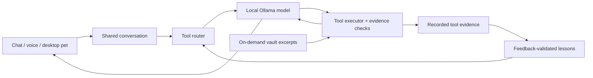

# Denisse

[](https://github.com/chuenchuen058/denisse/actions/workflows/checks.yml)

<p align="center"></p>

A Windows desktop assistant with a local Ollama language model, offline
speech recognition, persistent conversation, and tools for everyday laptop
work. Chat and spoken replies attach to an animated purple orb.

The language model runs locally. Optional Inworld speech synthesis sends
reply text to a cloud service; Spotify, news and weather also use network
services. Text chat and local speech recognition need no cloud API key.

## Engineering focus

Denisse connects model-generated requests to real machine actions. The core
engineering problem is deciding which tools to offer, checking what actually
ran, and reporting the result without inventing success.

- **Bounded tool loop:** requests get relevant tools rather than every schema;
  execution and retries are limited, including recovery from malformed calls.
- **Evidence checks:** unsupported completion claims, invented document paths
  and missing task results have deterministic regression checks.
- **Separate history and context:** shared conversation recording keeps tool
  evidence; model replay contains recent prose rather than raw tool traffic.
- **Feedback learning:** independently accepted corrections can change
  phrase-specific routing. Evidence is deduplicated and negative feedback can
  demote lessons. This does not train model weights.
- **Responsive desktop interaction:** attached chat, hover controls, reminders,
  timers and speech cancellation, including replies still being synthesized.
- **Standing instructions:** persistent task/project reviews and Downloads
  rules, scoped tools, checked results, restart cooldowns and a pause switch.
  See [Independent work](docs/standing_instructions.md).

This is a personal engineering prototype. The local model still makes
incorrect tool choices and weak conversational replies; the tests below
separate implementation regressions from model quality.

## Quick start

Use **Windows and Python 3.12**. The audio implementation uses `audioop`,
which is unavailable in Python 3.13. Desktop CI currently targets Windows.

```powershell
git clone https://github.com/chuenchuen058/denisse.git
cd denisse
python -m venv .venv
.venv\Scripts\python.exe -m pip install -r requirements.txt
```

To inspect the engineering checks first, no model or API keys are needed:

```powershell
.venv\Scripts\python.exe scripts/run_checks.py --report logs/checks.json
```

For text chat, install and start [Ollama](https://ollama.com), then:

```powershell
ollama pull llama3.1:8b
.venv\Scripts\python.exe main.py
```

The default model context is 8192 tokens. Model resources and response times
vary with hardware. `DENISSE_MODEL` and `DENISSE_NUM_CTX` are optional
configuration variables; see [.env.example](.env.example).

To use the desktop orb:

```powershell
.venv\Scripts\python.exe tray.py
```

The tray starts background Downloads sorting and temporary-file maintenance.
Its menu lets you pause these features. Start with the text CLI if you want
to explore the assistant before enabling desktop maintenance.

## Desktop and voice

Click the orb or its hover-only **Chat** icon to open a conversation beside
it. Dragging the orb moves the chat; placement flips near screen edges.
**Voice** toggles wake-word listening and **Reminders** opens the task card.

Typed and spoken replies share the open chat. With chat folded away, a small
reply bubble offers **Continue chat**, **Stop voice**, and **Dismiss**.
Type or say **shush** or **stop talking** to silence current and pending
tray speech without another spoken acknowledgement. Spoken controls require
wake-word listening to be enabled and remain dependent on recognition quality.

For offline recognition, download the Vosk model once:

```powershell
.venv\Scripts\python.exe scripts/download_vosk_model.py
.venv\Scripts\python.exe voice_mode.py
```

`voice_mode.py` is push-to-talk. Hands-free mode is available from the tray
or `wake_word.py`. Microphone audio is transcribed locally with Vosk.
Standalone voice mode uses the local system voice when Inworld is unavailable;
the tray's typed replies stay text-only without Inworld configured.

Inworld is optional, paid cloud speech synthesis, configured with
`INWORLD_API_KEY`. See [.env.example](.env.example). Spotify integration is
also optional and requires its own account configuration.

More controls and interruption details: [Pet chat](docs/pet_chat.md).

## Independent work

Enable the three supported standing jobs with private settings:

```powershell
.venv\Scripts\python.exe scripts/standing.py --init --enable
```

While the tray runs, Denisse reviews open tasks every six hours, checks this
project's local Git status hourly and applies the existing Downloads rules
every 15 seconds. Task and project reviews propose next steps; they do not
complete tasks or edit code. Downloads stays deterministic and works without
Ollama. Pause with **Independent work** and inspect **What Denisse did** in the
tray. [Setup, permissions and verification](docs/standing_instructions.md).

## Architecture



| Component | Responsibility |
|---|---|
| `brain.py`, `tool_router.py` | Model interaction, relevant tool selection, bounded execution and reply checks |
| `tools.py`, `tasks.py`, `timers.py` | Local actions and application state |
| `conversation.py`, `memory_store.py` | One process-level brain, recent replay and appended history |
| `brain_rules.py`, `learning.py`, `instincts.py` | Validated preferences and correction evidence |
| `tray.py`, `floating_orb.py`, `orb_controls.py`, `reminder_card.py` | Desktop pet, attached chat and cards |
| `stt_vosk.py`, `voice_output.py`, `speech_control.py` | Recognition, speech playback and interruption |
| `vault_search.py`, `obsidian_sync.py` | Optional bounded knowledge retrieval and memory mirroring |

## Knowledge and preferences

The assistant works without an Obsidian vault. To use your own, set the
`DENISSE_VAULT` environment variable before starting the process. Vault
lookups retrieve bounded excerpts on demand; the whole vault is not loaded
into the system prompt. The current-project overview quotes recent dated
sections of `Memory/STATE.md`, which must be maintained separately.

Create supported preferences without overwriting an existing file:

```powershell
.venv\Scripts\python.exe scripts/brain_settings.py --init
```

Private preferences live in `memory/brain_rules.json`; the template is
[brain_rules.example.json](brain_rules.example.json). Facts are saved only
when explicitly requested by default. Corrections followed by `/good` or
"that worked" can build candidate lessons; two independent accepted fixes
are needed for activation. `/bad` marks a failure.

See [Adaptive brain](docs/adaptive_brain.md) for validation, evidence rules,
off switches and the limits of this learning mechanism.

## Verification

**Offline regression gate:** `scripts/run_checks.py` runs ten explicit suites
in separate processes with scratch vault/rule paths and service keys disabled.
It requires no Ollama server, downloaded model, microphone or personal history.
The same command runs on pushes and pull requests in
[GitHub Actions](https://github.com/chuenchuen058/denisse/actions/workflows/checks.yml).
The JSON summary records suite exit codes and durations rather than transcripts.

**Real-model checks:** with Ollama running, test model decisions using synthetic
conversations and harmless tool fixtures:

```powershell
.venv\Scripts\python.exe scripts/eval_dialogue_reliability.py --rounds 3 --out logs/dialogue.json
```

The most recent recorded three-round run on 27 October 2026 passed **16/21**
scenarios. This is a small local-model evaluation, not a general reliability
score. Passing mocked regressions does not imply every model answer is correct.

**Desktop checks:** `scripts/smoke_pet_chat.py` requires an interactive Windows
desktop. It uses synthetic history and checks placement, scaling, reply actions
and window lifecycles. Native microphone and audio quality need separate tests.

Generated reports, downloaded models, credentials and personal memory stay out
of Git. Avoid publishing local diagnostic reports that include personal data.

## Action boundaries

Typed shell commands, file writes and app opening currently run without a
confirmation prompt, following the original user's configuration. Startup
program disabling still asks. Hands-free mode additionally asks before shell
commands and file writes. See [safety.py](safety.py) for the actual policy.
The assistant is not a hardened sandbox for untrusted instructions.

Speech cancellation does not undo actions already performed. Learning cannot
grant new mutating tools or bypass execution checks. Obsidian integration,
news, Spotify and maintenance are separate from the local language model.

## Next work

- Improve model tool-choice reliability on held-out, repeated scenarios.
- Reduce coupling between model orchestration, desktop code and tool effects.
- Make optional integrations easier to configure on a fresh machine.
- Prepare a reproducible demo using synthetic tasks and files.

Model-weight fine-tuning remains a separate future experiment requiring curated
data and held-out evaluation. Current feedback learning adjusts routing only.
