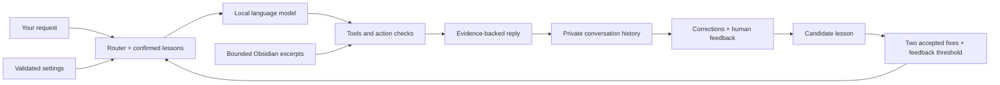

# Denisse's adaptive brain

This is feedback-driven tool routing and retrieval, **not model-weight training**.
The local model, tool executor, stored history and Obsidian knowledge remain
separate components with explicit responsibilities.



## Teach her

1. Give a normal request.
2. If it is wrong, correct it: **"No, I meant my current projects."**
   You can also type **`/bad`**, then give a related corrected command.
3. When the correction works, type **`/good`** or say **"that worked"**.
4. A second independent accepted correction for the same original phrase
   can activate its routing lesson. Re-reading the same conversation does
   not count twice. Multiple failed attempts before one accepted fix still
   count as **one** confirmation.

Learning runs after saved turns and during nightly maintenance, without an
extra model call. A tool call succeeding on its own is not enough; silence
is not approval. At least 80% of the lesson's recorded feedback must be
positive. Negative feedback can return a lesson to candidate status.
Lessons match the original phrase, apart from polite fillers; they do not
generalise one word such as "timer" across every timer command.
For an explicitly corrected current-project request, a confirmed lesson
also selects the existing bounded vault overview. It never learns arbitrary
tool arguments; conflicting meanings leave the query unchanged.

The learner prioritises tools and may add **read-only** tools. It cannot
grant a new machine-changing tool, remove existing tools, rewrite Python or
system prompts, or bypass confirmations/action checks. It also does not
train the language model. Synthetic test lessons are never installed in
your actual store. This does not guarantee every future answer is correct.

Explicit `/good` and `/bad` commands stay in the private learning record but
are omitted from model replay, so they do not consume recent-request slots
or become canned dialogue examples. Use the tray chat or persistent CLI
history; ephemeral tests are intentionally not saved as learning data.

## One editable preferences file

```text
memory/brain_rules.json
```

Create it without overwriting existing preferences, or inspect its status:

```powershell
.venv\Scripts\python.exe scripts\brain_settings.py --init
.venv\Scripts\python.exe scripts\brain_settings.py
```

The public template is `brain_rules.example.json`. Supported settings:

| Setting | Default | Effect |
|---|---|---|
| `recent_turns` | `6` | Recent requests replayed; range 1–10 |
| `style_examples` | `true` | Use the existing conversational examples |
| `save_facts` | `"explicit"` | Only offer fact-writing when asked; `"conversation"` restores broader availability |
| `vault_search` | `true` | Enable on-demand Obsidian lookup |
| `vault_max_notes` | `3` | Maximum note/excerpt count; range 1–5 |
| `vault_max_chars` | `1200` | Strict lookup-result budget; range 400–2000 |
| `context_max_age_days` | `14` | Dated overview freshness window; range 1–90 |
| `self_learning` | `true` | Observe feedback and apply validated routing lessons |
| `learning_confirmations` | `2` | Independent accepted fixes needed; range 2–10 |

Edits apply on the next request. Unknown keys, wrong types and out-of-range
values are rejected. Invalid edits retain the last valid settings in that
process (or defaults on first load); the status command reports the error.
Deleting the file restores defaults. Existing environment off-switches
`DENISSE_INSTINCTS=0` and `DENISSE_VAULT_SEARCH=0` still take precedence;
`DENISSE_STYLE_EXAMPLES` overrides the style setting. Tests can select an
isolated file with `DENISSE_RULES_FILE`.

These settings select supported behaviours; arbitrary text is **never**
loaded as a system prompt. The action guards are code invariants, not
editable instructions from a note.

## Connected knowledge

Ask **"What am I working on?"** or **"Catch up with my current projects."**
The vault tool can quote the latest eligible dated sections of
`Memory/STATE.md`, with source and section dates, within the character
budget. This is recorded context, not live task or computer status.
Overview replies preserve the bounded source excerpt and recorded dates
directly; an unverified model summary cannot change them.
Specific questions still use ordinary note search; tasks, facts and machine
status retain their own tools. No whole-vault prompt injection is enabled.

The quality of this overview depends on keeping the current-state note
accurate. Older historical notes remain searchable but do not become the
current-state overview just because they mention a keyword many times.

Ask **"What rules do you follow?"** or **"Are you learning?"** to inspect
the actual settings and lesson counts instead of a model-invented answer.

## Inspect or disable a lesson

Private lesson files live in the configured vault's `Denisse/Brain/`:

- `instincts.json` — authoritative, with evidence IDs and enabled flags.
- `instincts.md` — generated readable candidate/active/off summary.

Set a lesson's `enabled` to `false` to disable it; observations preserve
that choice, including migration from legacy entries. Legacy lessons without
validated evidence stay inactive. Set `self_learning` to `false` to freeze
observation and routing effects without deleting history or learned data.
The store uses an inter-process lock and atomic replacements. Updates are
idempotent, and confirmed evidence survives the 200-message history window.

Preferences and conversation-derived lessons stay out of the public code
repository. Review human feedback critically: politeness can be noisy, and
the confidence threshold is a practical rule, not a scientific guarantee.

## Checks

```powershell
.venv\Scripts\python.exe scripts\test_adaptive_brain.py
.venv\Scripts\python.exe scripts\test_dialogue_reliability.py
.venv\Scripts\python.exe eval\test_self_correct.py
.venv\Scripts\python.exe scripts\eval_adaptive_brain.py
```

The adaptive model comparison uses a synthetic correction pair and scratch
vault only. It measures whether a learned phrase reaches the right tool
with learning on versus off. Real tool/task regression checks are separate;
a successful routing demonstration is not proof of general intelligence.
