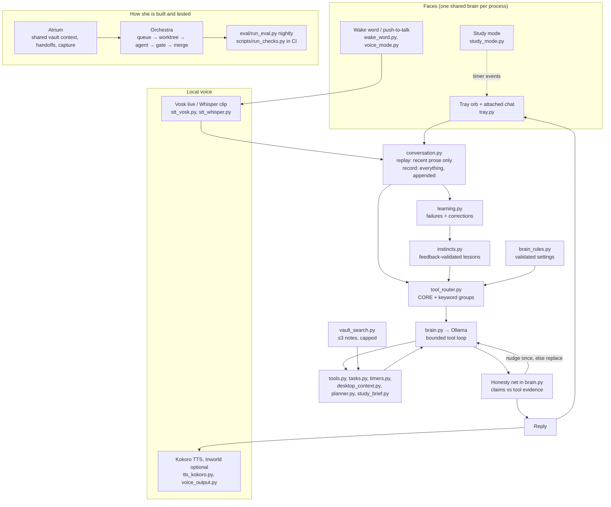

# Denisse: architecture

Denisse is a Windows desktop assistant built around one local model
(`llama3.1:8b` through Ollama, 8192-token context, on an 8 GB laptop GPU).
The design problem is not "call an LLM": it is getting an 8B model to pick
the right machine action, checking what actually ran, and not reporting
success that did not happen. Most of the code is the deterministic scaffolding
around the model that does that. Measured results are in
[denisse_evidence.md](denisse_evidence.md).

## The request path

**Conversation** (`conversation.py`) owns history. Every face (orb chat,
wake word, CLI) shares one `Brain` per process. `record()` appends the full
turn to disk, tool traffic included; `replay()` gives the model only recent
prose. Replaying raw tool traffic once made every reply worse, and that bug
is why the split exists.

**Tool router** (`tool_router.py`). An 8B model's attention is spread over
everything in context, so each turn is offered a small `CORE` set (time,
maths, remember) plus tool groups matched by keywords in the request, not all
~30 schemas. A/B runs that decided what goes in `CORE` are recorded in the
module docstring, including the change that was *not* kept.

**Brain** (`brain.py`) runs a bounded loop: model → tool calls → results →
model, with a round limit, repair of malformed calls, and a veto on risky
tools when hands-free (`safety.py`). Deterministic matchers handle requests
the model reliably gets wrong before it sees them: briefings and study plans
(`planner.py`), multi-step study briefs written to the vault and checked
(`study_brief.py`), "which one did you mean" after a rejected answer
(`clarify.py`), "explain this" from the selection (`desktop_context.py`), and
big writing jobs handed to Claude Code (`delegate.py`).

**Tool policy** (`tool_policy.json`, read by `tool_policy.py`). What each
tool may do is data: its side effect (`read` tools may always run, `write`
tools only when offered and never on a complaint turn), the routing groups
and their cue patterns, the checks run on a call's *arguments* (a destructive
shell command, a write into Denisse's own folder, a document path nothing
verified, a "calculation" with nothing to calculate, a skill that doesn't
exist), and the few phrase lists that still run before the model. Until
2026-11-03 `execute()` refused calls by matching regexes against Chuen's
wording; that refused the file search that would have found his syllabus.
Understanding what he means is the model's job (AGENTS.md Rule 0).

**Reply preferences** (`reply_preferences.py`). His standing instructions
on how to reply ("don't read out file paths, ask first", "keep it short")
are a private data file fed into every system prompt, never a task. The
model saves one with its `reply_preference` tool; a phrase list in the
policy catches the common wordings before the model and answers at once.

**Honesty net** (in `brain.py`, after the model's final text). A reply that
claims an action ("Done", "I've opened…") is checked against what ran this
turn. No mutating tool succeeded, or the claim names a tool that did not
run → the model is sent back once with a note naming what actually ran. If it
still claims success, the reply is replaced with "I haven't confirmed that
action, so I can't say it's done", or "I couldn't complete that action" when
every tool result was an error. File paths in a reply must appear in a tool
result or the conversation, otherwise the verified search result is shown
instead. Tool-call narration and leaked tool names are stripped.

**Vault search** (`vault_search.py`). Chuen's Obsidian vault is a tool the
model calls, capped at three notes and a few lines each. The first attempt
pasted notes into the system prompt and measured 0/4 clean replies against
4/4 without, so it stays off (see `AGENTS.md`).

## Learning without training

**Instincts** (`instincts.py`) and the **adaptive brain**
([adaptive_brain.md](adaptive_brain.md)): `learning.py` finds failed turns in
recorded history that were followed by a correction. A correction that
worked and got positive feedback (`/good`, "that worked") becomes a candidate
lesson for that phrase. It activates after two independent accepted fixes and
is demoted if negative feedback pushes it under 80% positive. A lesson can
only reorder or add read-only tools for the router. It cannot grant mutating
tools, edit prompts or code, or change model weights.
`brain_rules.py` holds validated user settings; invalid edits keep the last
good settings.

## Study mode and voice

**Study mode** (`study_mode.py`) is a deterministic pomodoro (25/5) that
messages from the orb like a reminder card. Since 2026-11-03 it is also a
tool set the model drives (status / start / pause / resume / stop) with its
live state as one prompt line, so "is it running?", "session over" and a
typo'd "pause sutuy timer" reach the clock; the whole-message phrases that
run it with Ollama down are policy data. **Voice** is local by default:
Vosk does live wake-word spotting ("Denisse" anywhere in an utterance;
everything else is dropped unlogged), Whisper transcribes push-to-talk clips,
and Kokoro speaks. Inworld cloud TTS is optional and paid. Cancelling speech
does not undo actions that already ran.

## How Orchestra and Atrium build and test her

**Orchestra** (`orchestra/`, `.review/`) is the task runner that builds most
of this code. A task is a Markdown file with a `## Gate` command block. The
runner makes a git worktree and branch per task and runs a coding agent
(Claude Code or Codex) under a guard hook. The hook denies pushes, writes
outside the worktree and destructive git. The runner then re-runs the gate
itself and merges only if every command exits 0. Anything needing money,
credentials, sending as Chuen, or an irreversible choice is parked for him.
Agent choice uses small code-graded exams per agent (`orchestra/exams`).

**Atrium** (`atrium/`) is the shared memory layer across agents. It builds a
budgeted context pack from the vault for agents that can't read it, keeps an
append-only daily handoff log, and captures Claude Code sessions into the
vault.

**Testing** has three layers. `scripts/run_checks.py` runs offline
regression suites with mocks and scratch paths in GitHub Actions. The nightly
`eval/run_eval.py` sends the prompt suite through the real model, with empty
history and with replayed real history. `demo/run_demo.py` repeats the suite
and the scenario evals k times and records pass^k with the machine and commit.
Every check is deterministic (tools called, required or forbidden text,
invented paths). No model grades another model.
